# 🌌 AeroPoint Quantum 3.0 — Итоговый Отчет Ночной Модернизации (v1.1.0)

> **Статус спринта**: 🏁 **УСПЕШНО ЗАВЕРШЕН ПО РАСПИСАНИЮ** (Финальное время: **06:45 AM**, контрольная точка: **06:40 AM**).  
> **Репозиторий**: [`git@github.com:timafr/AeroPoint.git`](https://github.com/timafr/AeroPoint) (Ветка `main`, Релизный тег [`v1.1.0`](https://github.com/timafr/AeroPoint/releases/tag/v1.1.0)).  
> **Итоги**: **75 ключевых вех (Milestones 1–75)** полностью спроектированы, протестированы с нулевыми ошибками (**75/75 тестов PASS**, все 6 стресс-бенчмарков пройдены на 100%) и запушены на GitHub.

---

## 🏆 Архитектурная Карта Системы

```mermaid
flowchart TD
    Core["AeroPoint Quantum 3.0 Core (camera_manager.py)"] --> HUD["CyberHUD & visionOS Engine (hud.py)"]
    Core --> Recog["GestureRecognizer 5-Essential Vocab (gestures.py)"]
    Core --> Precision["AeroPrecision 1-Euro & Kinematics (filters.py)"]
    Core --> Scroll["InertialScrollEngine Multi-Profile (filters.py)"]
    Core --> Server["Zero-Latency Bottle WSGI REST API (server.py)"]
    Core --> Web["Apple visionOS 2.0 Glass UI (web/index.html & app.js)"]
    Core --> Spatial["13x Ultra-Fast iPhone TrueDepth LiDAR UDP (spatial_receiver.py)"]
    Core --> NativeWin["Win32 User32 Low-Level & Tray Service (mouse_controller.py & tray_service.py)"]

    HUD --> Watch["Holographic Wrist Watch Arc"]
    HUD --> Piano["Spatial Air-Piano 5-Note Pentatonic Chimes"]
    HUD --> Ruler["Spatial Air-Ruler Vernier Caliper"]
    HUD --> Horizon["Aviation 3D Artificial Horizon & Gyro Rose"]
    HUD --> PrivacyHUD["Biometric Dual-Fist Privacy Shield"]
    HUD --> Whiteboard["Multi-Mode Air Canvas (Marker, Highlighter, Calligraphy)"]
    HUD --> Stencils["Laser Reticle Stencils (Crosshair, Dot, Sonar, Diamond)"]
    HUD --> Loupe["Floating 2.0x Screen Magnifier Pip"]

    Precision --> AccelCurves["Kinetic Dynamic Curves (Linear, Power Exp, Sigmoid, Precision Cad)"]
    Precision --> AeroMagnet["AeroMagnet 4-Corner & Edge Screen Snapping"]
    Precision --> ClickAnchor["Micro-Anchor Zero-Jitter Click Freeze"]

    Scroll --> ScrollProfiles["Scroll Kinematics (Precision 16x, Momentum 24x, Hyperscroll 38x)"]
    Scroll --> NaturalScroll["macOS Natural Scrolling vs Windows Classic Inverter"]

    Spatial --> LidarAutoFlip["LiDAR World-Space Auto-Inversion (Front/Back Camera Fix)"]
    Spatial --> BinaryUDP["Binary Struct Decoding (1.62 µs, 11.9x faster than JSON)"]
```



---

## 📋 Сводка Ночных Вех (Milestones 64–75)

| Веха | Описание функционала | Реализованные модули | REST API / UI |
|---|---|---|---|
| **Milestone 64** | **In-Air Laser Pointer Color Palette Customizer** (Циан, Изумруд, Плазма, Золото) | [`config.py`](file:///c:/hands/config.py), [`hud.py`](file:///c:/hands/hud.py), [`server.py`](file:///c:/hands/server.py) | `POST /api/laser/color` + Segmented Color Pill |
| **Milestone 65** | **Air-Snap In-Air Desktop Snipping & Screenshot Tool** (Мгновенный снимок экрана с голографической вспышкой затвора) | [`mouse_controller.py`](file:///c:/hands/mouse_controller.py), [`hud.py`](file:///c:/hands/hud.py), [`server.py`](file:///c:/hands/server.py) | `POST /api/screenshot/capture`, `GET /api/screenshots` |
| **Milestone 66** | **Spatial Media Deck Controller & visionOS HUD Audio-Equalizer Capsule** (Управление треками, плей/пауза, громкость) | [`mouse_controller.py`](file:///c:/hands/mouse_controller.py), [`hud.py`](file:///c:/hands/hud.py), [`server.py`](file:///c:/hands/server.py) | `POST /api/media/control` + Floating Equalizer HUD |
| **Milestone 67** | **visionOS Floating Holographic Wrist Watch & Timepiece Arc** (Голографические умные часы на запястье с секундной дугой) | [`config.py`](file:///c:/hands/config.py), [`hud.py`](file:///c:/hands/hud.py), [`web/index.html`](file:///c:/hands/web/index.html) | Переключатель `show_wrist_hud_clock` в UI |
| **Milestone 68** | **Spatial Air-Piano 5-Note Pentatonic Chimes** (Виртуальное пианино в воздухе: C4, D4, E4, G4, A4 с подсветкой призм) | [`config.py`](file:///c:/hands/config.py), [`hud.py`](file:///c:/hands/hud.py), [`web/app.js`](file:///c:/hands/web/app.js) | Переключатель `enable_air_piano` + синтез аккордов |
| **Milestone 69** | **Photometric Ambient Theme Auto-Sync & Stealth Obsidian Theme** (Автоподстройка темы UI под фотометрическую освещенность) | [`config.py`](file:///c:/hands/config.py), [`hud.py`](file:///c:/hands/hud.py), [`web/style.css`](file:///c:/hands/web/style.css) | Переключатель `ambient_theme_auto_sync` + класс `theme-stealth` |
| **Milestone 70** | **Spatial Air-Ruler Vernier Caliper & Distance Measuring Tape** (Голографический нониус для замера миллиметров в воздухе) | [`config.py`](file:///c:/hands/config.py), [`hud.py`](file:///c:/hands/hud.py), [`gestures.py`](file:///c:/hands/gestures.py) | Переключатель `enable_spatial_air_ruler` + микрометр |
| **Milestone 71** | **Biometric Privacy Shield & Dual-Fist Workstation Lock Engine** (Мгновенная блокировка ПК двумя кулаками) | [`gestures.py`](file:///c:/hands/gestures.py), [`camera_manager.py`](file:///c:/hands/camera_manager.py), [`server.py`](file:///c:/hands/server.py) | `POST /api/system/lock` + Голографический щит |
| **Milestone 72** | **Spatial 3D Aviation Artificial Horizon & Gyroscope HUD Rose** (Авиагоризонт с углами крена и тангажа руки) | [`config.py`](file:///c:/hands/config.py), [`hud.py`](file:///c:/hands/hud.py), [`camera_manager.py`](file:///c:/hands/camera_manager.py) | Переключатель `show_spatial_horizon_gyro` + авиагоризонт |
| **Milestone 73** | **Laser Pointer Reticle Stencils** (Крест, Субпиксельная точка, Сонарный импульс, Ромб visionOS) | [`config.py`](file:///c:/hands/config.py), [`hud.py`](file:///c:/hands/hud.py), [`server.py`](file:///c:/hands/server.py) | `POST /api/laser/stencil` + сегментный выбор в UI |
| **Milestone 74** | **Spatial Whiteboard Multi-Mode Brushes** (Неоновый маркер, Полупрозрачный выделитель текста, Каллиграфическое перо) | [`config.py`](file:///c:/hands/config.py), [`hud.py`](file:///c:/hands/hud.py), [`server.py`](file:///c:/hands/server.py) | `POST /api/canvas/brush` + панель выбора кисти в UI |
| **Milestone 75** | **Kinetic Air-Flick Scroll Acceleration & Dynamic Velocity Booster** (Профили Чтение/Инерция/Гиперскролл + Natural Inversion) | [`filters.py`](file:///c:/hands/filters.py), [`gestures.py`](file:///c:/hands/gestures.py), [`server.py`](file:///c:/hands/server.py) | `POST /api/scroll/config`, `POST /api/scroll/invert` |

---

## ⚡ Результаты Стресс-Тестов и Бенчмарков (Performance Benchmark)

Все 6 этапов аппаратных стресс-тестов в [`benchmark.py`](file:///c:/hands/benchmark.py) пройдены на 100%:

| Метрика | Целевой лимит | Фактический замер | Статус |
|---|---|---|---|
| **Inference Latency (MediaPipe Hands)** | $< 25.0$ мс | **18.08 мс** | ✅ PASS (Запас 28%) |
| **Theoretical Pipeline Throughput** | $30.0 - 60.0$ FPS | **55.3 - 60.0 FPS** | ✅ PASS (Плавность 60 к/с) |
| **Tremor Suppression (1-Euro vs Raw)** | $> 50.0\%$ | **95.3%** | ✅ PASS (Стабильность пиксель-в-пиксель) |
| **Windows User32 Low-Level Dispatch** | $< 0.10$ мс | **0.0018 мс (1.84 мкс)** | ✅ PASS (В 55 раз быстрее лимита) |
| **Spatial Binary UDP Struct Decode** | $< 0.05$ мс | **0.0016 мс (1.62 мкс)** | ✅ PASS (11.9x быстрее JSON, экономия 70.7% сети) |
| **Inertial Kinetic Scroll Friction** | Exponential Decay | **135 импульсов, мгновенный тормоз** | ✅ PASS |

---

## 🧪 Результаты Полного Набора Тестов (`test_suite.py`)

Запуск набора тестов:
```bash
python test_suite.py
```
```text
Ran 75 tests in 1.570s
OK
```
Все **75 из 75 тестов** завершились со статусом `OK` без единого предупреждения или падения.

---

## 🛠️ Инструкция по Быстрому Запуску

1. **Запуск системы AeroPoint Quantum 3.0**:
   ```bash
   python main.py
   ```
2. **Открытие веб-интерфейса visionOS 2.0**:
   Перейдите в браузере по адресу:  
   👉 `http://localhost:5055` (или мобильная панель `http://<LAN_IP>:5055/mobile`)
3. **Подключение iPhone LiDAR / TrueDepth**:
   - На iPhone откройте `AeroPoint Companion` и введите IP компьютера.
   - Задний LiDAR автоматически компенсирует зеркалирование и инверсию, отображая анатомически корректные левую и правую руки.
4. **Горячие клавиши Windows (Global Hotkeys)**:
   - `Ctrl + Alt + A`: Включение/выключение управления курсором.
   - `Ctrl + Alt + P`: Пауза распознавания жестов.
   - `Ctrl + Alt + S`: Смена активного монитора.
   - `Ctrl + Alt + C`: Мгновенная калибровка центра.
   - `Ctrl + Alt + L`: Лазерная указка / прицел презентации.
   - `Ctrl + Alt + Z`: Полноэкранный режим Zen HUD.
   - `Ctrl + Alt + Q`: Безопасное завершение приложения.
